{width=39%}

::: {custom-style="Cover Title"}
Open Foris Arena Mobile
:::

::: {custom-style="Cover Text"}
Version {{version}}

[https://www.openforis.org/arena-mobile/](https://www.openforis.org/)
:::

::: {custom-style="Cover Subtitle"}
User Manual
:::

::: {custom-style="Cover Text"}
{{releaseDate}}
:::

{width=37%}

::: {custom-style="Cover Text"}
**Forestry Division, FAO**
:::

{width=16%} {width=23%} {width=33%}

```{=openxml}
<w:p><w:r><w:br w:type="page"/></w:r></w:p>
<w:sdt><w:sdtPr><w:docPartObj><w:docPartGallery w:val="Table of Contents"/><w:docPartUnique/></w:docPartObj></w:sdtPr><w:sdtContent><w:p><w:pPr><w:pStyle w:val="TOCHeading"/></w:pPr><w:r><w:t>Contents</w:t></w:r></w:p><w:p><w:r><w:fldChar w:fldCharType="begin" w:dirty="true"/></w:r><w:r><w:instrText xml:space="preserve"> TOC \o "1-2" \h \z \u </w:instrText></w:r><w:r><w:fldChar w:fldCharType="separate"/></w:r><w:r><w:fldChar w:fldCharType="end"/></w:r></w:p></w:sdtContent></w:sdt>
```

# Introduction

Arena Mobile is a free and open-source data collection app developed under the FAO [Open Foris initiative](https://openforis.org/). This app provides the opportunity to record field data using mobile devices such as tablets or mobile phones. Arena Mobile offers Android and iOS versions that can be downloaded and installed from the Google Play Store and App Store.

The app is designed to streamline and improve data collection in an integrated environment by combining the [Open Foris Arena](https://openforis.org/solutions/arena/) online database with a mobile data collection tool. The Arena platform operates only online (in the cloud), but the Mobile app enables offline data collection. With the help of Arena templates, it is fast to tailor a new data collection survey (i.e., forms) and start using the app in a field data collection campaign.

Several digital data recording applications are available that can facilitate field data recording. However, Arena Mobile offers functionality, flexibility, and data hosting advantages. It supports complex data structures and methods for real-time data validation, which ensures better quality data. Users can detect all errors and navigate to them for checking and correcting. A wide range of data types can be recorded effectively and processed using this tool, such as numbers, coordinates, polygons, boolean values, images, videos, audio recordings, taxonomic data, texts, and coded attributes.

Different selections and visualization options for surveys or data collection forms are available; those can be customized according to the user's preferences. Data collected using the Arena Mobile app is hosted in cloud-based servers (Amazon Web Services, AWS), which offers a secured data hosting service. However, a [customized server](https://github.com/openforis/arena) for hosting users' data can be established and connected with the app. The Arena platform facilitates cloud computing with the help of the R language calculation chain.

Arena Mobile can be used in several languages, and the Arena surveys can be built to show labels in any language.

With Arena Mobile, you can collect data in offline mode and store it locally on your device. However, an internet connection is required for the following tasks: installation of the app, logging into Arena, downloading or updating a survey, sending data to the server (manually or with auto-sync), downloading records from the server, and downloading offline maps.

# Key Features

Once you have installed the application on your device, you are ready to use it. The main features of Arena Mobile are as follows:

1. It is an offline data collection app;
1. The app can support surveys in multiple languages;
1. All common data types are supported, including coordinates, polygons (geospatial attributes), images, videos and audio recordings;
1. Supports preset default values, data relevancy ("relevant if"), conditionally required, editable and visible attributes, and validation rules;
1. Automatic saving of data while recording or editing data;
1. Automatic resizing of images to fit the file size limit specified in the survey design;
1. Effective detection of errors and warnings during the recording of data or via a Validation Report page;
1. Record completion progress: see at a glance how much of the record has been filled in;
1. Allows selecting the closest "sampling point" based on current location;
1. Navigation to a target (point) position, with a compass or a radar view;
1. Accuracy of the coordinate points can be detected with the help of an in-built accuracy detection view;
1. Support for external Bluetooth GPS receivers;
1. Position tracking: the path walked while filling in a record can be recorded;
1. Maps: offline map areas, georeferenced PDF maps, custom map layers and records shown on a map;
1. Access to the Arena server using the user's credentials or a QR code, with support for two-factor authentication;
1. Easy to download or update a survey from the server;
1. Submission of collected data to the Arena server, manually or automatically in the background (auto-sync);
1. Allows downloading existing records from the server to continue editing them on the mobile app;
1. Export of the collected data to CSV files;
1. Supports multi-cycle surveys:
    1. show values from previous cycle data;
    1. clone records from a previous data collection cycle to the current cycle;
1. Supports user groups: records of other user groups can be viewed (read-only);
1. Data filling in form or single node (one attribute at a time) view mode;
1. GPS locking: GPS can be locked at all times when activated to allow using GPS with the best accuracy possible.

# Getting started

## Installation

**Access to an app store:** Visit the Online Store; depending on the device's operating system, it could be "[Play Store](https://play.google.com/store/apps/details?id=org.openforis.arena_mobile)" for Android users and "[App Store](https://apps.apple.com/sa/app/open-foris-arena-mobile-2/id6741569376?platform=iphone)" for iOS users. The installation process for both device types from their respective stores is similar.

{width=23%} {width=8%}

**Search for the application:** When the application window opens, find the search bar at the top of the window, type "***Open Foris Arena Mobile***", and do the search. Find the "Open Foris Arena Mobile" application in the search list (published by *Open Foris Initiative* on the Play Store and by *FAO* on the App Store) and select it.

**Proceed to install on the device:** Once you press the icon, the application page will open. Find the **Install** button and press it. Read the description in the "*About this app*" section below the screenshots on the store's page and the data safety measures (by using the arrow key provided on the page).

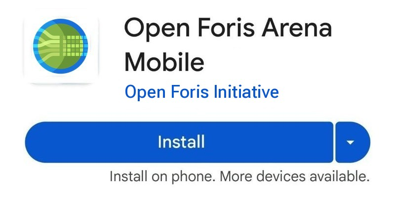{width=45%}

**App permissions:** The store page lists the permissions used by the app: **Location**, **Photos/Media/Files**, **Camera**, **Microphone** (audio attributes), **Bluetooth** (external GPS devices) and **Internet connection**. Arena Mobile asks you to allow each of them the first time it is needed (e.g. location when you record a coordinate, camera when you take a picture). If you do not allow them, the related features will not work.

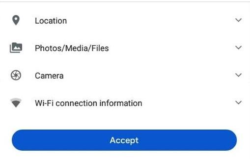{width=44%}

**Ready to use**: The application is ready to use once the installation is completed. The screen shows the **Uninstall** and **Open** buttons. You can either directly open the application from here or open it from the shortcut on the applications screen.

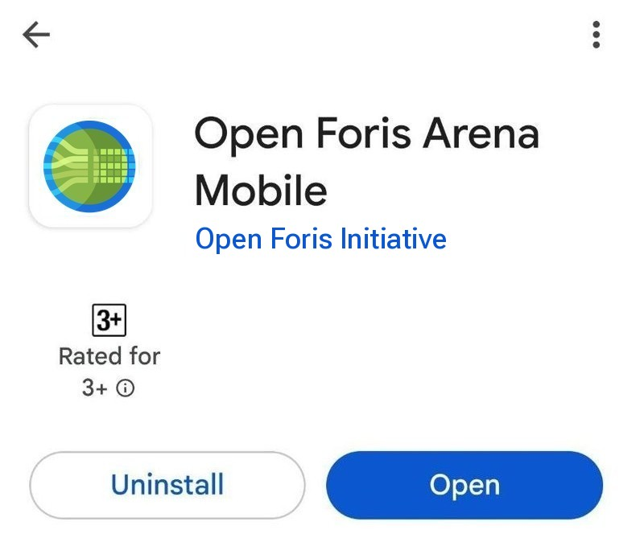{width=54%}

If you need to set permissions after an installation, follow this [guideline](https://support.google.com/android/answer/9431959) by Google.

On iPhone (iOS): open the *Settings* app, tap *Privacy & Security*, tap the Arena Mobile heading to see what permissions are currently enabled, and toggle app permissions on (or off).

## Home page

The home page shows the survey you are working with and gives access to the main sections of the app. The first time you open the app, a **What's new** dialog presents the latest features (you can see it again from the **About** screen).

**When no survey is selected**, a banner says *No survey selected*: press **Select a survey** to select or download a survey (see [Downloading a new survey into your device]).

**When a survey is selected**, the banner at the top shows:

- the name and label of the **current survey**, with an icon showing if a newer version of the survey is available on the server (see [Updating a survey]);
- the survey description, the link to the **Field manual** (if defined in the survey), your **role** and your **user group** (if the survey uses user groups);
- a **Records** summary: the **Total** number of records, the records **To upload** to the server and the records **With errors**, with the date of the last edit;
- the **Go to data entry** button, which opens the list of records (see [Data Entry]);
- the **Sync** button, which sends the new and updated records to the server (see [Data submission to Arena Server]).

Below the banner:

- **Account** (or **Connect**, if you are not logged in): opens the connection to the Arena server (see [Connection to Arena server]);
- **Surveys**: change, download or update surveys (see [Managing surveys on the device]);
- the version of the app, at the bottom of the page.

**Options menu** (the three dots in the top right corner) opens a menu to navigate to several sections:

- the user you are logged in with;
- **Surveys** (list of local and remote surveys); while editing a record, this item is replaced by **Records** (list of records) and **Field manual** (if defined in the survey);
- **Offline maps** (see [Maps]);
- **Settings**: general settings of the app (e.g. language, theme, font size, etc.);
- **About**: information about the app, what's new, the change log and links to the support forum;
- **Exit** (only on Android): closes the app.

## Connection to Arena server

After the installation, establish a connection to the Arena server: on the home page, press **Connect** (or open **Settings** > **Connection to server**).

The app shows a login form with the following fields:

- **Server URL**: choose **Default** to use the default Arena server (<https://www.openforis-arena.org>) or **Custom** if your organization uses its own Arena installation (server), then enter its address; **Test URL** checks that the server can be reached;
- **Email** and **Password**: your user credentials, the same as what you filled in while doing the registration to the Arena platform. For more information about registration in Arena, please follow the [Arena User Guide](https://docs.google.com/document/d/1GWerrExvbdT5oOOlwdkE9pptK4pVbQxwtgaSNPasmKA/view).

Then press **Login**. The form also contains the links **Forgot password?** and **New to Arena? Request access**.

If you are a data entry person, then you may have received an invitation to Arena via your email, sent by your Survey Administrator (i.e., a person who manages the database). By following the link in the email, you can get registered and get credentials to access the Arena platform.

**Login using QR code**: instead of typing your credentials, you can log in by scanning a QR code generated by Arena:

1. open **Arena** in your web browser;
1. press the button in the top right corner and open the user menu;
1. select **Login from Arena Mobile using QR code**;
1. in Arena Mobile, press **Login using QR code** and scan the QR code displayed.

**Two-factor authentication (2FA)**: if two-factor authentication is enabled for your Arena account, after entering your email and password the app asks for the **2FA Code** generated by your authenticator app.

After a successful login, a dialog will appear; in that dialog, you can press the button **Continue** to go back to the home page.

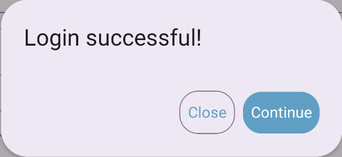{width=48%}

When you are logged in, the **Connection to server** screen shows the user you are logged in with and a **Logout** button.

> **Note:** If the version of Arena Mobile installed on your device is too old to work with the server, the app shows the message *App update required*: update the app from the store to continue.

## Downloading a new survey into your device

Once you are logged in, go back to the home page and press **Surveys** (or **Select a survey**, if you don't have any survey selected). A screen with the **Surveys in the device** will appear:

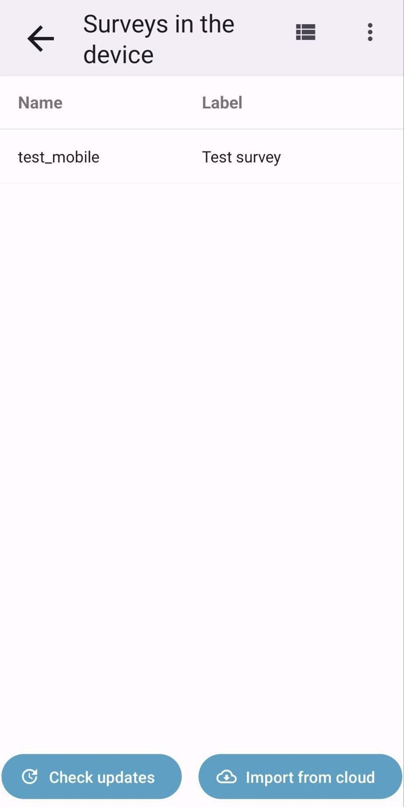{width=32%}

Press the button **Import from cloud** in the bottom right corner to download a survey from the remote server; a new screen will appear, showing all the surveys in the remote server that are available to your user:

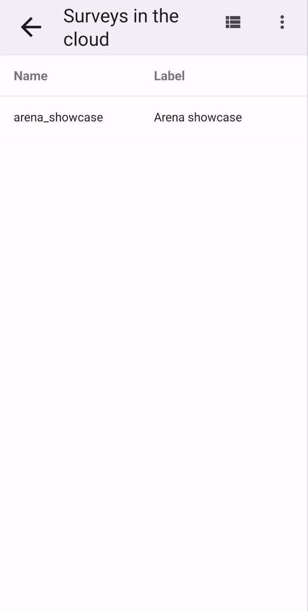{width=32%}

If you want to see more details about every survey, press the view mode button in the top bar; this button switches the view from a table to cards, where you can see more details like description, date of publish and load status (if the survey is already in the device or not, or if it is not up to date).

Press the row of the survey you want to import; a confirm dialog will appear.

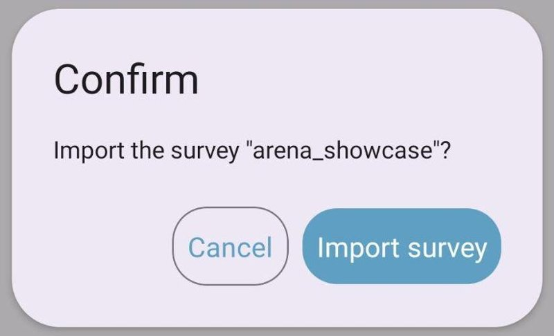{width=38%}

Once confirmed, the survey is downloaded together with its files (e.g. areas of interest), and you will be redirected to the page with the list of records collected with that survey (empty if the survey has been downloaded for the first time), and the data collection process can start:

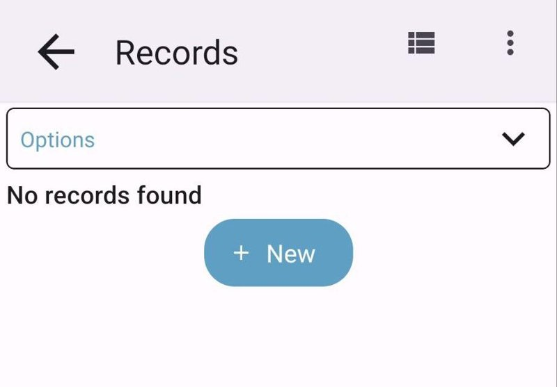{width=39%}

> **Note:** If only one survey is available to your user on the server, Arena Mobile downloads and selects it automatically.

# Managing surveys on the device

## Selecting a survey

Once a survey has been downloaded into the device, it is possible to work with it by selecting it in the list of surveys.

From the home page, press **Surveys**; in the **Surveys in the device** page, press the row related to the survey you want to use:

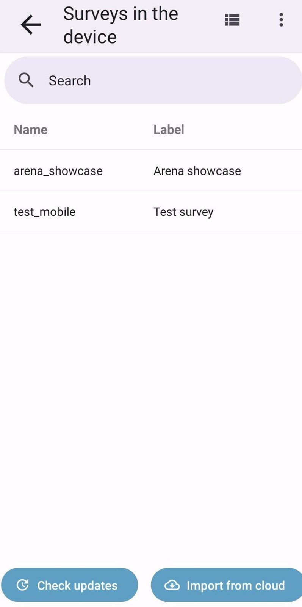{width=32%}

You will be redirected to the page with the list of records collected with that survey.

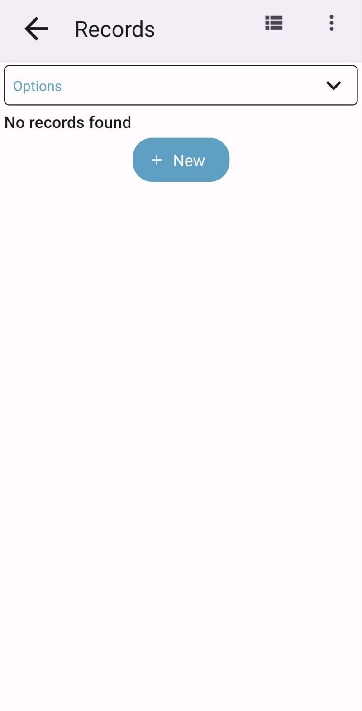{width=32%}

## Updating a survey

If you have already downloaded a survey on the device and the same survey is updated and published again on the Arena platform, and that survey is the "current" survey you are working with, the home page shows a warning icon next to the name of the survey.

Pressing the warning icon will show a confirmation dialog, to confirm the update of the survey:

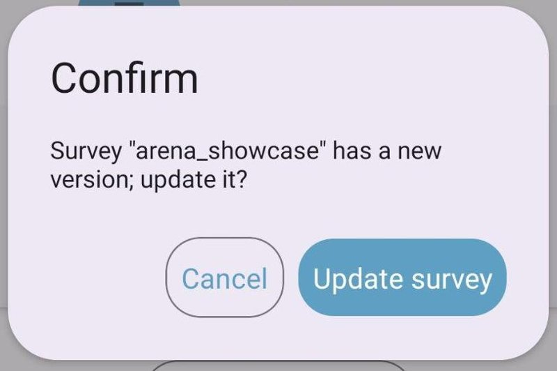{width=41%}

Once confirmed, the local copy of the survey will be replaced with the most updated one on the server.

> ***Note:*** *When a survey is updated and published in Arena, it is always recommended to update that survey in the Arena Mobile app.*

You can also update a survey from the **Surveys in the device** screen; press the **Check updates** button in the bottom left corner. For every row, you will see a small icon indicating the status of the survey. To update a survey that is not up to date, select the row of the survey you want to update and confirm the update:

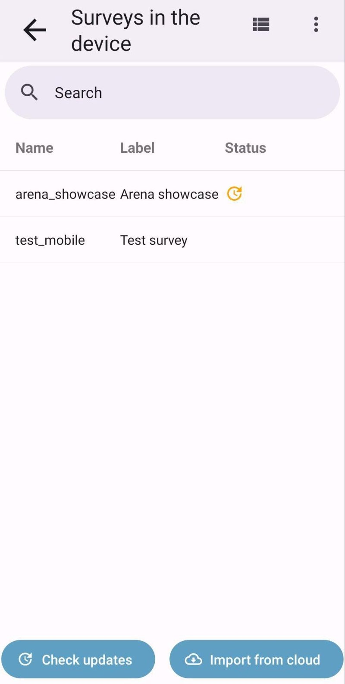{width=32%}

> ***Note:*** *Updating a survey will keep your data on the device. It will not be deleted. However, it is recommended to transfer all data to the server before running an update, and to keep a full local backup copy of the data!*

## Deleting a survey

If you want to delete one of the surveys you have downloaded on your device, **long-press on it**. It will show the delete option, then press the **Delete** button on top, and confirm the deletion.

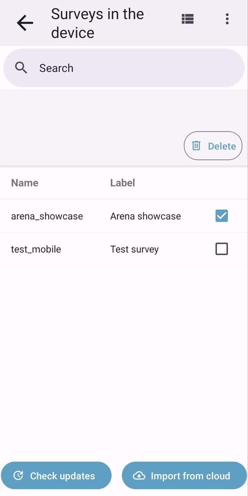{width=32%} 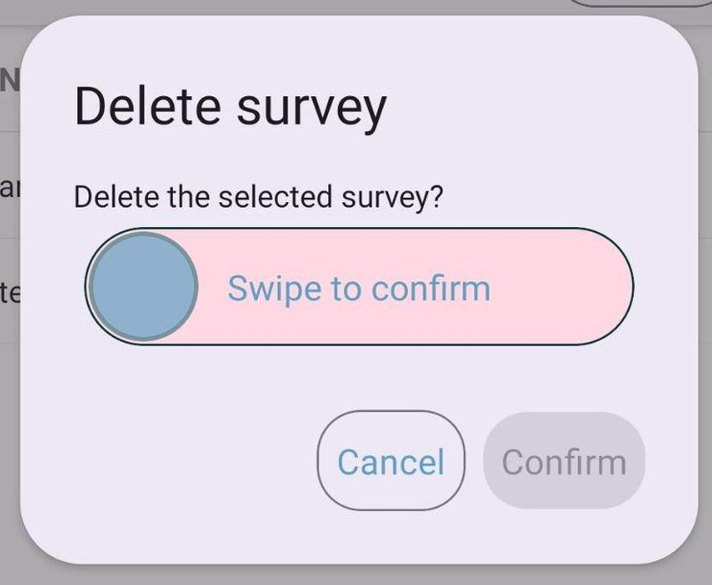{width=36%}

> **WARNING**: This operation will delete all the records and files/pictures collected using the selected survey (only locally; records stored on the server won't be touched). Do it only if you need to free up space in the device and you are really sure you won't need that survey anymore. Double-check that you have uploaded all the records to the server before deleting the survey.

# Settings and data backup

Press the menu icon button in the top right corner, then press **Settings**. Here, you will find options to make the app more user-friendly. Every setting shows a short description of what it does.

**Connection to server**: allows users to check, set, or change the credentials used on the Arena server.

**Appearance**

- **Application language**: the language of the app's user interface. Currently, the following languages are available: **English**, **Finnish**, **French**, **German**, **Bahasa Indonesia**, **Japanese**, **Persian**, **Portuguese**, **Russian**, **Serbian** and **Spanish** (if **System** is selected, the system language will be used if it is among the supported ones, otherwise English will be used by default). The language of the survey forms is chosen in the list of records.
- **Theme**: 2 "light" themes and 2 "dark" themes are available (choosing **Auto** makes the app follow the system color scheme: if the system uses a dark theme, then the Dark theme will be selected, otherwise the Light one).
- **Font scale**: increases or reduces the size of the text in the user interface.
- **Animations enabled**: turns on animations in the application (e.g., when an attribute becomes relevant, it will be shown with a fade animation); disable it to improve performance on slower devices.

**Data entry**

- **Auto sync**: uploads new and modified records to the server automatically (see [Auto-sync]).
- **Auto-sync interval while editing** and **Auto-sync interval (slow check)**: see [Auto-sync].
- **Data upload chunk size**: size of each piece a record is split into while uploading it to the server (from 500 KB to 50 MB). Lower values are more reliable on slow or unstable connections.
- **Full screen**: hides the system status and navigation bars.
- **Keep screen awake**: if turned on, the screen will never turn off while the app is open (it can reduce the battery life).
- **Show record completion progress**: shows the percentage of the record that has been completed (see [Record completion]).
- **Show status bar**: shows battery, storage and network status while editing a record.

**Location & GPS**

- **GPS source**: choose between the internal GPS of the device and an external Bluetooth GPS receiver (see [Using an external Bluetooth GPS device]).
- **Location accuracy threshold** (meters): used when a coordinate is being collected; when the threshold is reached, the GPS antenna is stopped automatically. The value can depend on the accuracy level that you want to reach, but it should not be lower than the maximum reachable by the device; otherwise, the GPS antenna will always try to reach an impossible value (e.g. in a good smartphone, 2 meters is a good value).
- **Location accuracy watch timeout** (30–300 seconds): when the timeout is reached, the GPS antenna is stopped automatically (by default, it's 120 seconds).
- **Location averaging enabled**: the recorded location will be the average of multiple location readings, improving accuracy.
- **GPS locked**: the GPS signal will be locked while the app is running, so that collecting coordinates will be faster and more accurate (it will reduce battery life since the GPS antenna is always turned on).
- **Position tracking accuracy threshold**, **Position tracking min distance** and **Position tracking battery saver**: see [Position tracking].

**Maps**: map provider, default map layer, custom map layers, offline maps and PDF maps (see [Maps]).

**Images**: maximum size (0.5–10 MB) images are resized to before being saved, unless the survey defines a smaller limit for a specific attribute; choose **Images size not limited** to store images in the maximum resolution provided by the device.

**Backup**: pressing the button **Full backup** generates a full backup of all the data used by the app, including surveys, records, and files/images collected. When the button is pressed, a confirm dialog appears, showing the size that the generated file will have; after confirming, a share dialog will appear and you will be able to select an app to use the generated file (e.g. select the File Manager app to store the file in the preferred folder).

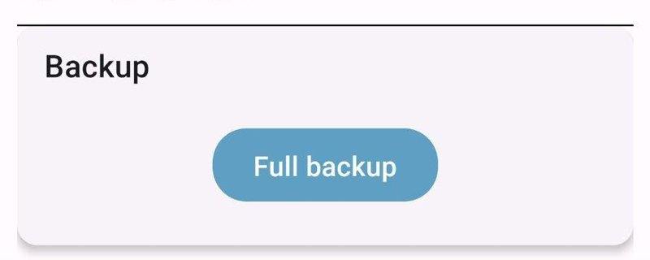{width=40%}

**Logs**: log files store diagnostic information that can help troubleshoot issues. **Export Logs** shares them (e.g. to send them to the support team); **Clear Logs** deletes them.

# Data Entry

Once a survey is downloaded into the device, it is ready to record data. While recording the data using the app, an internet connection is not needed. From the home page, press the **Go to data entry** button.

## Records page

You will be redirected to the Records page, where you can see the list of records collected using the current/selected survey (*empty if you don't have any records yet*).

In the record list, a column for every "key" attribute (attributes marked as key defined inside the root entity of your survey in Arena) and a column with Errors (if any) are shown.

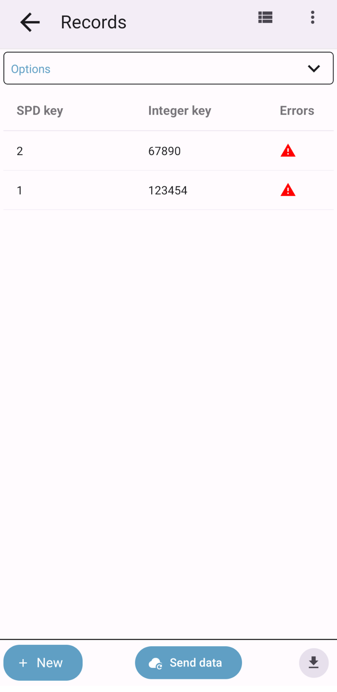{width=31%}

If you want to see more details about each record, press the view mode button on top to switch between the table view and the **cards** view. Records can be sorted using the sort field and direction shown above the list.

By pressing (*with a short press*) one of the rows, you will enter the record edit view.

**Note:** When you open an existing record, the record editor will open in read-only view mode; you will have to "**unlock**" the edit (by pressing the lock icon in the top bar) to be able to update its values.

If you want to start a new record, press the **New** button at the bottom of the screen 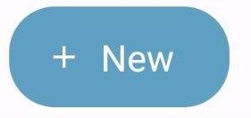{height=0.3in}.

**Options**: the panel at the top of the list allows you to:

- show **All records** or only the **Records in device**;
- choose the cycle of the records (in multi-cycle surveys) and the **Cycle for new records**;
- choose the language of the survey forms (in multi-language surveys);
- **Import** records from a file (a .zip file exported from Arena Mobile, e.g. with **Local backup**); select **Overwrite existing records** to replace the records already in the device;
- **Revalidate all records** (see [Re-validating records]).

**Selecting records**: long-press one or more rows to select them; the bar that appears on top allows you to **Clone** (into another cycle), **Fetch** (download from the server), **Export**, **Revalidate** or **Delete** the selected records.

**Records of other user groups**: in surveys using user groups, records belonging to another user group are marked as **Read-only**: they can be viewed or cloned, but not edited.

## Delete a record

If you want to **delete** a record, **long-press** the corresponding row and press the **Delete** button that appears on top:

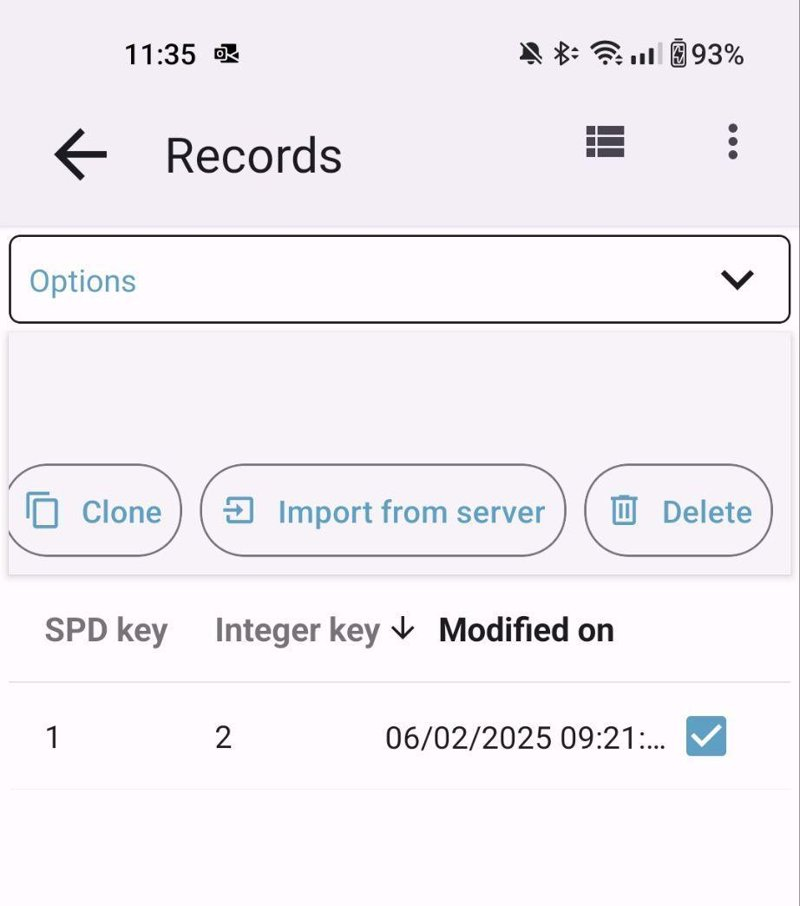{width=43%} 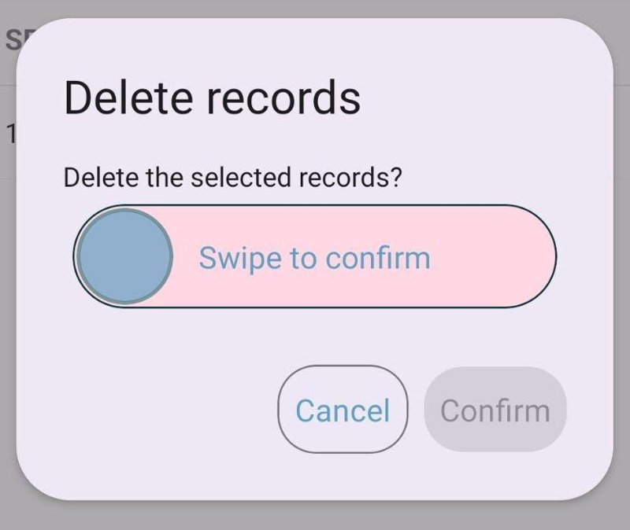{width=38%}

**Note**: The record deletion **cannot be undone**; it will remove all the data collected in that record (including files/images), but it won't affect data already submitted to the Arena server.

## Data entry form

*For the examples in this guide, we are using a demo survey; however, the basic data recording methods are the same for different surveys.*

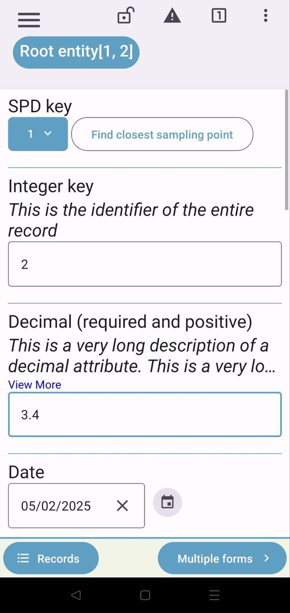{width=30%}

On the data entry page, there are 2 panels:

1. On the **Top panel**, you will find some icon buttons:
    - navigation sidebar trigger;
    - lock/unlock record edit;
    - validation report;
    - single node or form view mode switch;
    - options menu.
1. The **Lower panel** shows the "breadcrumbs" (where you can read in this example **Root entity[1,2]**); you can determine the position of the current page inside the record (i.e., the current entity name and the name of the ancestor entities, up to the root). It also contains "Records" and the next entity to check out.

**Navigation**

On the top left corner, you can see a "hamburger" icon {height=0.33in}. It opens a sidebar with a tree structure showing the hierarchy of the survey. Using this tree view, you can navigate to any page of the survey. If enabled in the settings, the sidebar also shows the record completion progress (see [Record completion]).

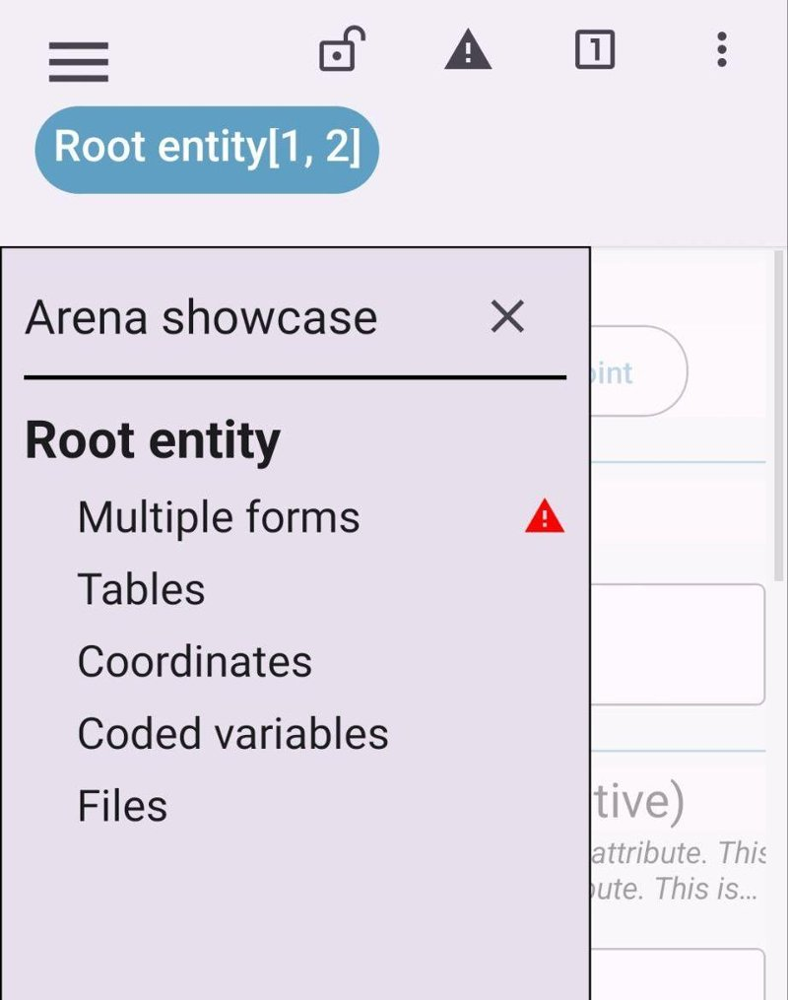{width=48%}

In the lower part of the side panel there are the navigation buttons, the **Records** button, a question mark (?) icon, which shows the documents attached to the survey, and the settings button.

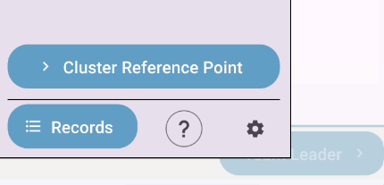{width=48%}

**Access to the record list**

At the bottom left of the survey hierarchy view, there is the **Records** button; by pressing it, you get access to the list of recorded data.

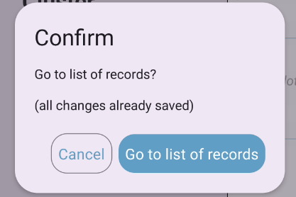{width=49%}

## Data types

Arena and Arena Mobile support collecting different data types. In this section, you will find how different data types are shown on the forms.

**Note:** data is always auto-saved in the device, and there isn't any "Save" button in the data entry form.

### Text

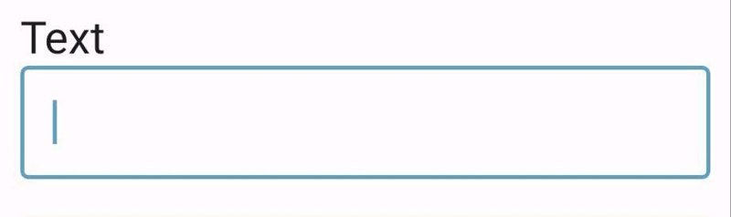{width=39%}

- Press the input box.
- Type in text using the keyboard that appears.

### Integer, Decimal

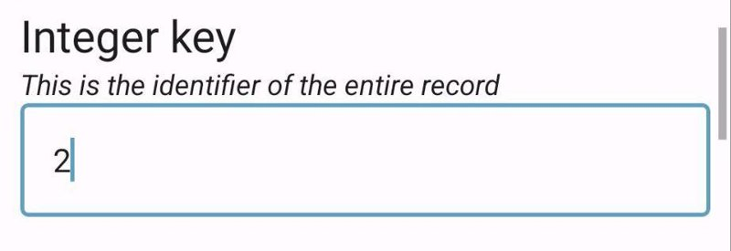{width=39%}

- Press the input box.
- Type the numeric value using the numeric keyboard that will appear (in case you cannot find a comma or dot symbol in the keyboard, consider installing a custom keyboard app, like Google GBoard or SwiftKey).

### Coordinate

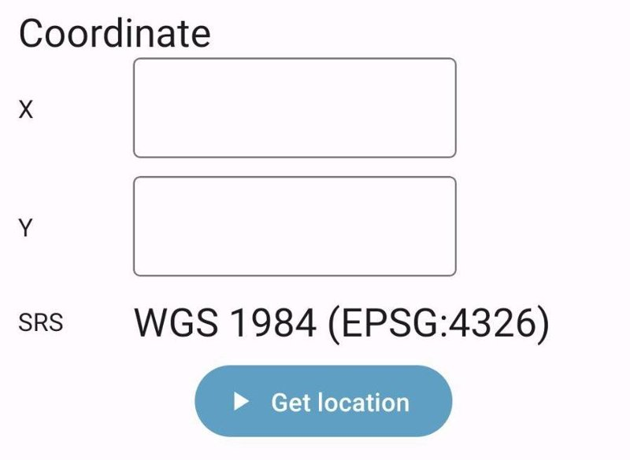{width=33%} 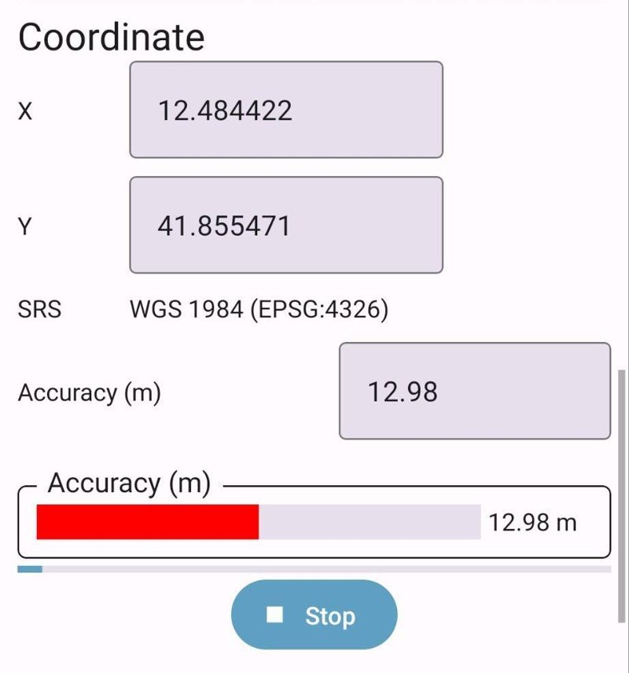{width=34%}

- Press **Get location**.
- Check the accuracy!
- Wait a bit to get better accuracy (green).
- The values you see in X and Y are the ones being stored in the data.
- When the accuracy threshold or the fetch timeout is reached (specified in the settings), the GPS antenna is automatically stopped.
- Press **Stop** if you cannot reach a better accuracy and you don't want to wait anymore.
- The location can also be viewed on a map: choose **Arena Mobile** (it works offline with downloaded maps) or **Other app…** (any installed app that can show a location). In the Arena Mobile map, you can also move the location: long-press the marker, move it, and press **Save new position**.

### Boolean

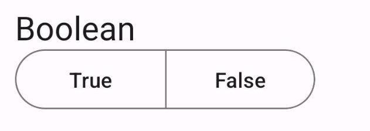{width=29%}

- Just press Yes or No (True or False).

### Code (dropdown, single or multiple entry)

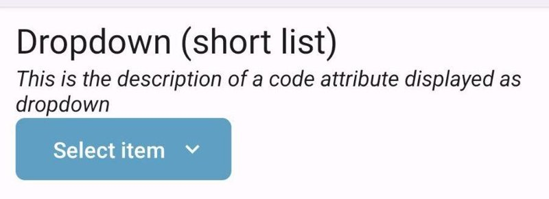{width=41%} 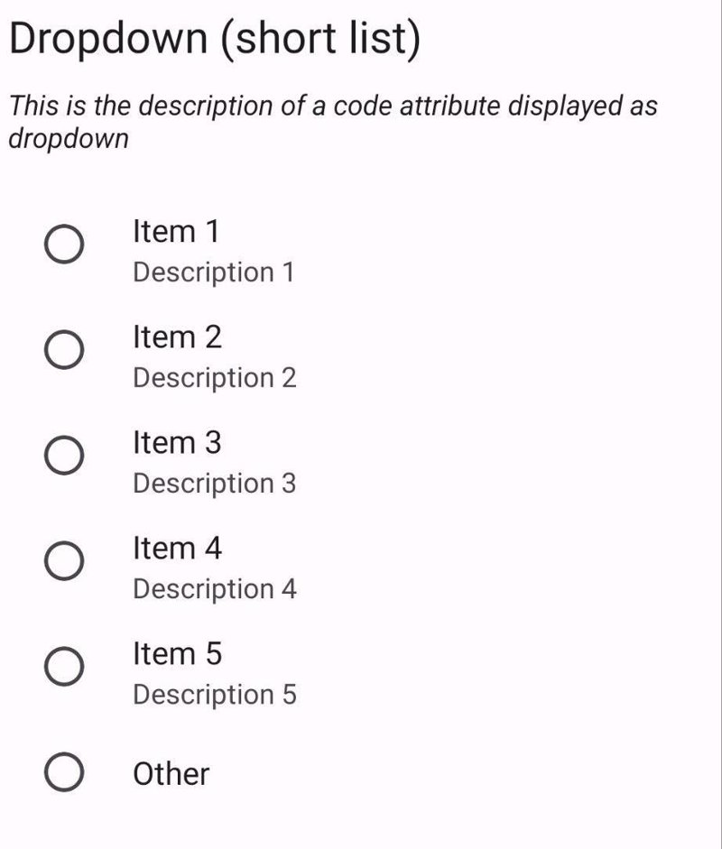{width=41%}

- Press the drop-down list.
- Select one option.
- If the code is "single", then the dialog is closed automatically after the selection, and the value will be saved automatically.
- If the code is multiple, multiple choices are allowed, and you will have to close the dialog with the button at the bottom.

### Code (checkbox or radio button, single or multiple entry)

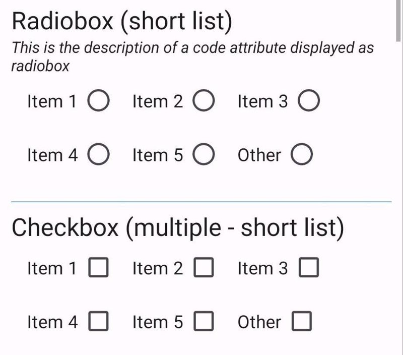{width=42%}

- All the items in the related category will be shown.
- Select one or more options (if the code is multiple).
- The selection(s) will be saved automatically.

### Taxon (taxonomic data)

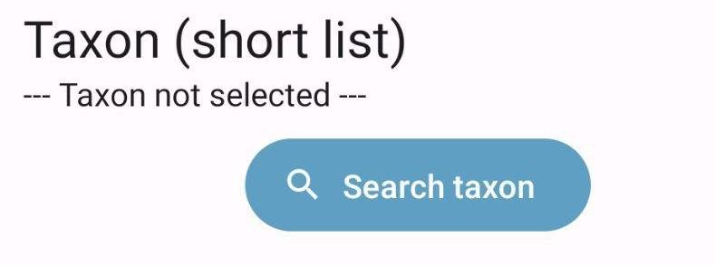{width=36%}

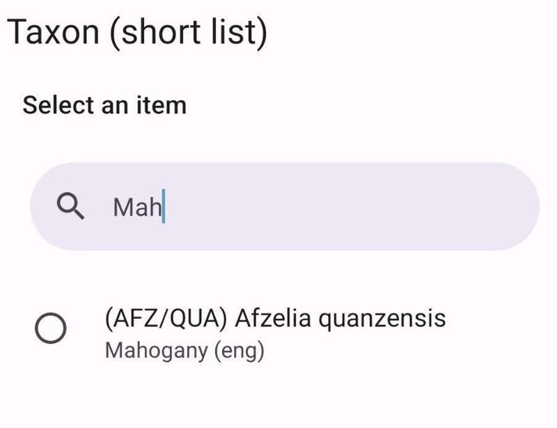{width=41%} 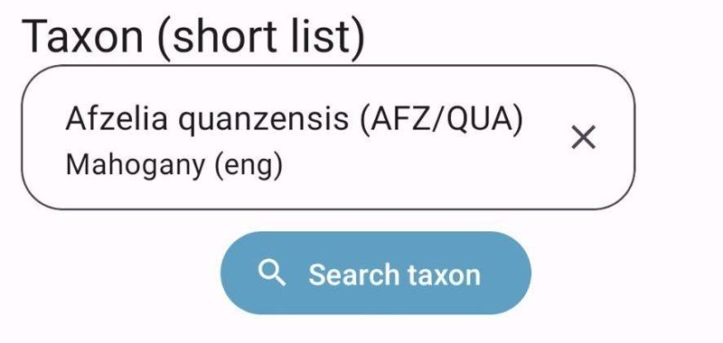{width=41%}

- Press the **Search taxon** button.
- A dialog appears with the species list.
- Type a few letters of the code, the scientific name, or the vernacular/local name into the search box to filter the visible items.
- Select one name from the list.
- The search dialog will be closed automatically.

### Date

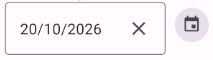{width=34%} 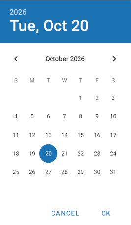{width=19%}

- Press the text box or the calendar icon.
- Choose the date using the calendar (the layout depends on the device).

### Time

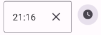{width=27%} 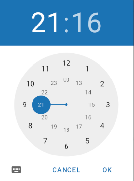{width=21%}

- Press the input text box or the clock icon.
- Choose the time using the time selector (the layout depends on the device).

### Files (photos, videos, documents)

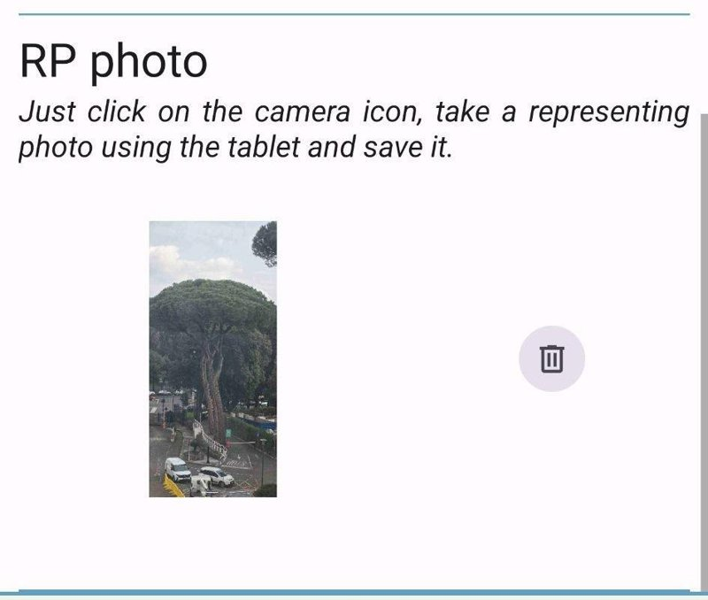{width=43%}

- Press the "Camera" icon button to capture a photo or a video.
- Press **Select picture** (or **Select video**, **Select file**) to pick a file from your device.
- In the case of an image file attribute, if a maximum size has been specified for the file in the Arena Survey Designer (or in the settings), the stored image will be resized to fit that size.
- Press the image:
    - to show a preview with some details like size and resolution;
    - to **Rotate** it;
    - to download or share it.

### Audio files

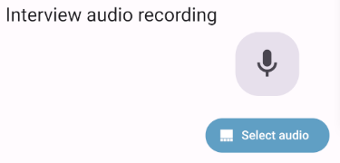{width=42%} 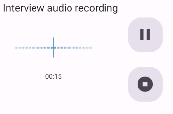{width=42%}

File attributes of type audio are supported. On the attribute you can:

- record audio directly with the device microphone (with pause and resume), or
- select an existing audio file with **Select audio**.

The recording can be played back, shared or deleted. It is stored with the record and uploaded to the server like images and videos.

### Geotagged photos

In the Arena Form Designer, this property has to be selected for a file attribute to enable geotagging of photos:

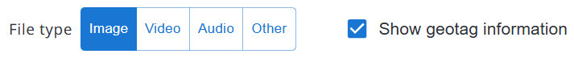{width=42%}

Arena Mobile allows you to capture or upload geotagged photos. These are images with location-specific metadata (i.e., latitude and longitude), embedded in the file's EXIF data. This information can be captured automatically by GPS-enabled devices.

### Geospatial (polygons)

Geospatial attributes store a polygon, e.g. the boundary of a site, a plot or a stand.

- Press **Draw polygon** and tap the map to add the points of the boundary; while walking along the boundary, you can also use **Add current location** to add your current location as a point. Press **Stop** when done.
- To edit the polygon (**Edit polygon**), tap a point to select it, then long-press it and drag it to move it; tap a midpoint to add a new point; use **Delete selected point** to remove the selected point. Then press **Save**.
- The polygon can be downloaded as a GeoJSON file (download button) or cleared (trash button).

The map used depends on the **Map provider** setting; with free map layers it works offline with the downloaded map areas (see [Maps]).

A geospatial attribute can also be marked in Arena as **Position tracking**: in this case its value is the path walked while filling in the record (see [Position tracking]).

## Navigating to the target location

If a **coordinate attribute** contains a validation rule with the "**distance**" or "**geoDistance**" function (e.g., *distance(this, target_location) < 100*), then in the data entry form, there will be the possibility to "navigate" to the target location (i.e., to the coordinate referenced by the distance function).

This feature requires only a good GPS signal. It does not require an internet connection.

In the coordinate attribute editor, a button with a compass icon will appear as follows:

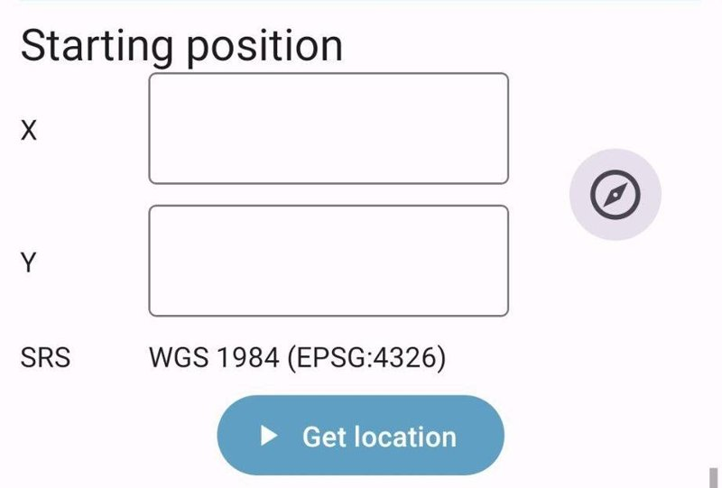{width=31%}

Pressing that button will open the **Navigate to target** dialog (Location Navigator), showing your position relative to the target:

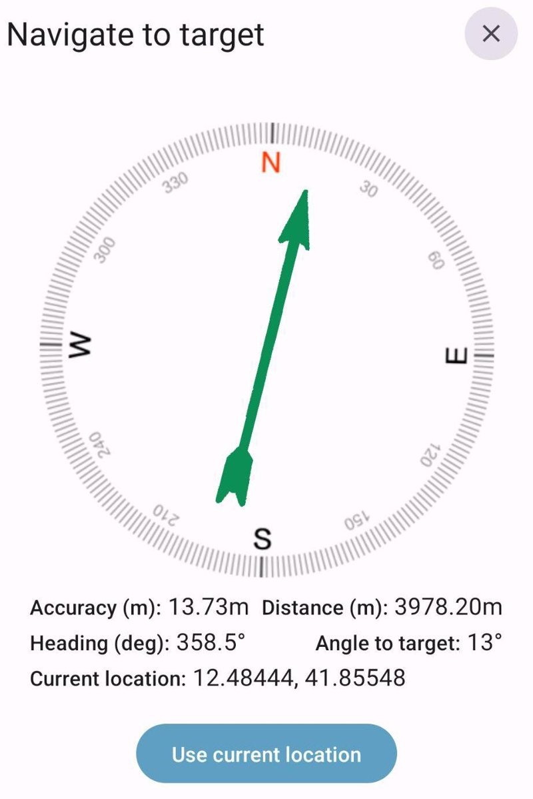{width=43%}

Two view modes are available:

- **Compass**: a rotating compass rose aligned to North, with an arrow pointing toward the target. When very close to the target, the arrow is replaced with a dot on the accuracy circle showing the target's relative position.
- **Radar**: a top-down view with your position fixed at the center; the target dot moves around you in real time to reflect its actual direction and distance.

The direction (heading) can be taken from two **heading sources**:

- **Sensor** (magnetometer): works while standing still, but can be affected by nearby metal objects or magnetic interference. Please notice that it requires that the device has a magnetometer sensor; some cheap models may not have it!
- **GPS**: derives the heading from your movement. More accurate in open spaces, but it requires you to be walking and may not be available on all devices.

The following information is shown:

- accuracy of the measured coordinate,
- distance to target (in meters),
- heading (azimuth angle from North[^north]),
- angle to target (relative to North),
- current location (in latitude-longitude).

The arrow can have three colors, as follows:

- green: the difference between the angle to target and the heading is less than 20° (you are going in the right direction),
- orange: the difference is less than 45°,
- red: the difference is greater than 45°.

Following the arrow and the distance to the target will guide you to reach the target location without looking at a map. Press **Use current location** to use your current location as the value of the coordinate attribute.

[^north]: Mobile device's compass typically points to the magnetic north, not true north. The magnetic north is based on the Earth's magnetic field, while true north refers to the geographic North Pole. You might be able to calibrate your device's compass with a known declination value. This means that, depending on your location, your device can adjust readings to provide more accurate direction relative to true north.

## Finding the closest sampling point

When a **code attribute** uses the "**sampling_point_data**" as a category table, each item in the category can have a coordinate associated with it. In this case, the user has the possibility to see the closest sampling point based on their current location.

Close to the dropdown where the user can select the category item, the button **Find closest sampling point** will appear:

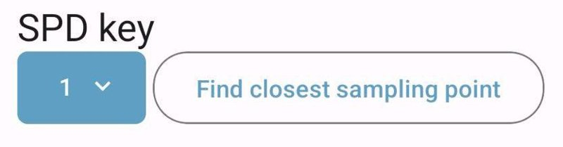{width=43%}

Pressing that button will open a new dialog; Arena Mobile will start fetching the current location:

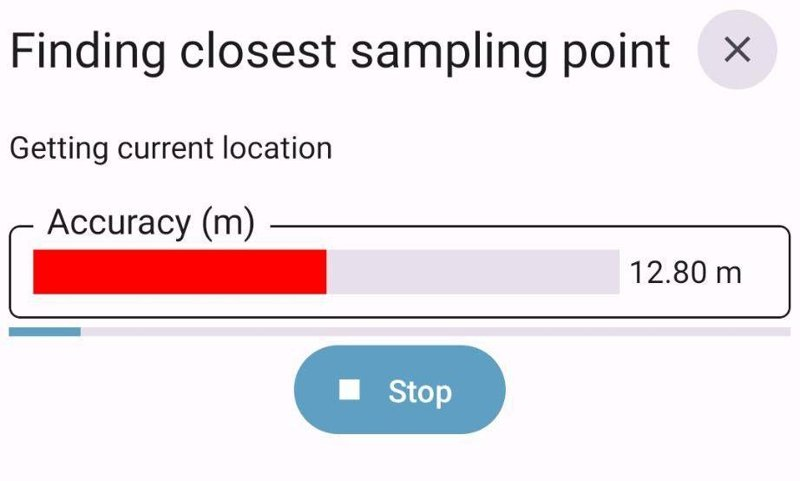{width=39%}

When the location has been fetched, one or a list of possible points will appear with the distance from the current location. These will be shown as follows:

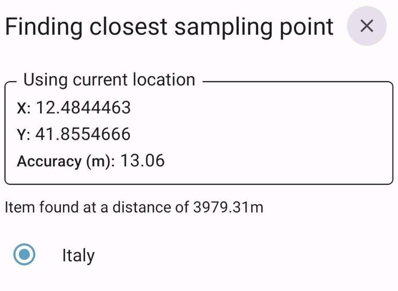{width=43%}

Confirming the selection (**Use selected item**) will close the dialog and let the user go back to the data entry form.

## Single node view mode

By default, Arena Mobile shows the data entry form like a "form" with the attributes arranged vertically in a single column.

The "single node" view mode can be useful especially when working with small devices: it helps to focus on one particular attribute at a time.

If you want to switch to the "single node view mode", press the icon {height=0.25in} in the top bar while you are editing a record (the icon will turn into this {height=0.23in}: press it again to go back to the form view mode).

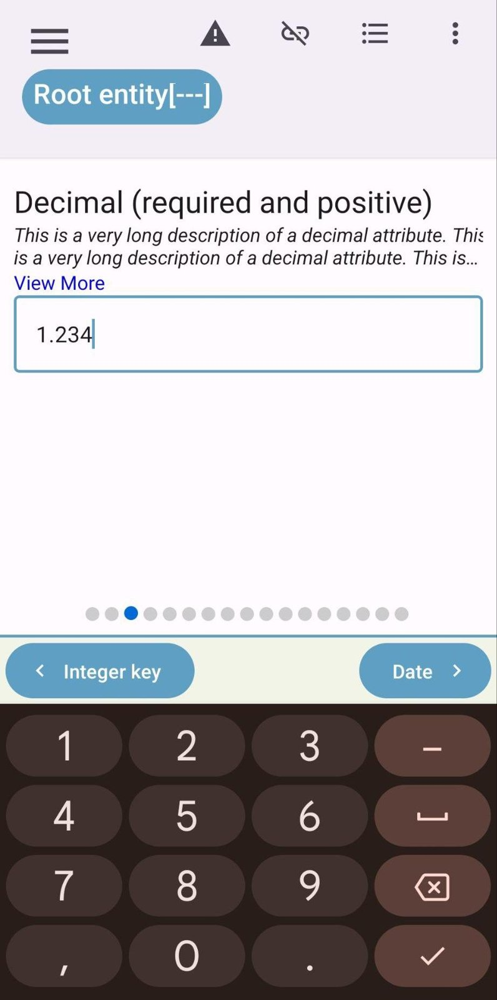{width=32%}

A dotted bar will appear below, showing the position of the current attribute inside the current entity.

You can navigate from one attribute to another inside the same entity:

- swiping from left to right or from right to left;
- using the buttons in the bottom bar: left (**<**) and right (**>**).

Also, the left side navigation panel will change in this view mode, showing the list of attributes inside the current entity:

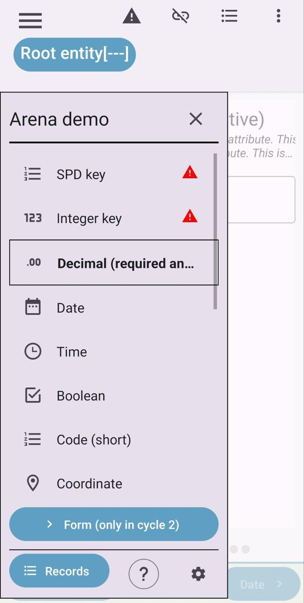{width=32%}

## Data entry with multiple entities (forms or tables)

When filling data for a multiple entity (that can have a table or form layout), Arena Mobile shows a landing page with a preview of the collected entities:

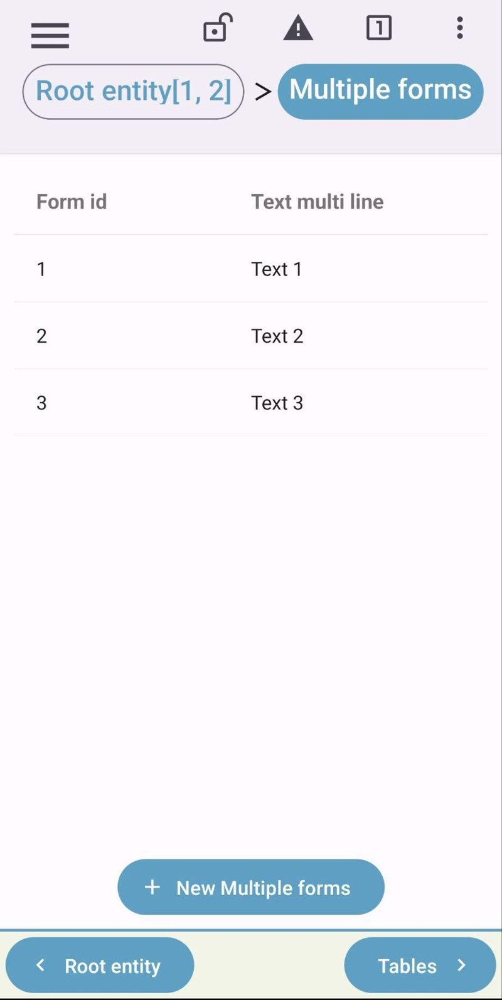{width=32%} {width=32%}

On this page, it is possible to edit an entity by pressing the corresponding row or delete one or more entities by long pressing the corresponding rows and pressing the **Delete** button that appears.

The attributes shown in the list are the key attributes and the attributes marked with "Include in multiple entity summary" in the Arena survey designer. When the key attributes are few and there is space (for example, when using a tablet or when rotating the smartphone and using it with landscape orientation), other attributes in the entity will be shown (up to 5).

The list can be sorted by pressing the column headers. Press **Columns** to choose the **Visible columns**: key attributes, summary attributes and other attributes can be shown or hidden (**Show all**, **Hide all**, or **Default** to go back to the default columns).

## Link to the record in the previous cycle

In a survey with multiple cycles, the user can "link" the record being edited to a record in one of the previous cycles (if the record key matches the one of a record previously inserted).

When editing a record in a multiple-cycle survey, the top bar changes, and another button will be visible:

{width=72%}

Pressing that button will open a dialog, where you will have to specify the cycle you want to link to (if the cycles are more than 2, otherwise there will be only one previous cycle to link to):

{width=34%}

Once confirmed, Arena Mobile will look for a record in the selected cycle matching the same keys as the current one. First, it will try to look for the key among the records already in the device; otherwise, it will look for it in the remote server. If the record is found, it will ask for a confirmation to "fetch" the record from the server. If the record is not found, you will see a message at the bottom of the screen:

{width=68%}

Otherwise, you will see a confirmation message saying that the record has been fetched:

{width=29%}

The icon in the top bar will change, and for every attribute in the record, you will see a box containing the value in the linked previous cycle record:

{width=32%}

## Key attributes locking

To avoid changing them by mistake, key attributes that already have a value are locked: a lock icon is shown next to their label. Press the lock icon to unlock the attribute and change its value.

## Record completion

A progress bar shows how much of the record's requirements are already met (e.g. *64% completed*). It is shown at the top of the navigation sidebar, where each page also shows a status icon (completed, partially completed or not started):

{width=40%}

The record completion progress can be turned off in **Settings** > **Data entry** > **Show record completion progress**.

## Values that no longer apply

When a change makes other attributes or entities not applicable (their "relevant if" condition is no longer met), Arena Mobile asks for confirmation before clearing them:

- A dialog titled *Nodes will no longer apply* lists the affected attributes and entities.
- Confirming clears their values; cancelling keeps the previous value of the attribute you were editing.
- The values are cleared also when the change is caused by adding or deleting an entity.

## Auto-sync

With **Auto sync** enabled, Arena Mobile uploads new and modified records to the server automatically in the background, whenever an internet connection is available. It can be enabled with the **Auto sync** switch at the bottom of the list of records, or in the settings.

- The **sync status icon** (in the records list and in the record editor top bar) shows: all records synchronized; records pending (they will be sent automatically); synchronization in progress (with percentage); records that need your attention; offline; session expired (log in again to resume).
- Tap the icon to open the **Sync status** dialog, where you can also turn auto-sync on or off and use **Sync now** to sync immediately.
- The record open in the editor is uploaded only after it has been left untouched for the interval set in **Auto-sync interval while editing** (1–15 minutes).
- Once everything is synchronized, the app checks the server for changes made from other devices every **Auto-sync interval (slow check)** (2–60 minutes).
- While auto-sync is running, sending data manually is not possible until it finishes.

> **Note:** Auto-sync may increase battery and mobile data usage when not on Wi-Fi.

## Records modified on several devices

If the same record was modified both on the device and on the server (for example, two team members adding trees and deadwood to the same plot), auto-sync merges the two versions automatically, without asking, provided the survey allows downloading records in Arena Mobile:

- For each attribute, the most recently edited value is kept; entities added on either side are kept.
- After the merge, the merged record is downloaded and replaces the copy in the device (only files not already in the device are downloaded).
- If the merged record is open in the editor, it becomes read-only for a few seconds (*This record is being synchronized with the server*) and is then reloaded on the same page.

> **Note:** A merge never deletes data: an entity deleted on one device can come back if the other device still has it.

Some records cannot be synced automatically until you fix them: records without key values, records that are no longer in the data entry step, or records with the same key(s) as another record on the server when merging is not allowed. Check their sync status in the records list.

> **Note:** Changes are detected using the date of the device: make sure that the date and time of the device are correct. Records edited while the device date was behind the server date are not uploaded until you set the correct date and time and edit them again.

## Merging records with the same keys

When sending data, records that have the same key values as a different record already on the server can be merged into it (**Merge conflicting records**), if the survey administrator allowed it in the survey security settings. Otherwise those records are not sent: change their key values if they are different records, or contact the survey administrator if they are the same.

For records modified both on the device and on the server, the app asks to confirm the merge (**Merge records edited on both devices**) by swiping.

## Re-validating records

If a record shows errors or warnings in the list that cannot be found when editing it, its validation can be recomputed:

- select one or more records and choose **Revalidate**, or
- use **Revalidate all records** in the options of the list of records.

# Data quality control

## Real-time data validation

Arena Mobile supports real-time data validation. With the help of built-in data validation rules in the survey, Arena Mobile can search and list the possible errors in the input data. Arena supports a simple to complex set of [validation rules](https://docs.google.com/document/d/1FsD1kARO7wtY-ZYXR84TFTDn2JhRlKsVDJdqPvEXkpk/view) and conditions to be fulfilled during the field data collection.

{width=53%}

## Validation report

The Validation Report can show a complete list of errors and warnings in the survey data, based on the validation rules set for the survey.

It is highly suggested to review the **Validation Report** every time and fix the errors before submitting the data to the server.

To access the Validation Report, press the icon {height=0.29in} in the top bar. The validation report will be shown on a separate screen:

{width=39%} {width=41%}

By selecting an issue on the Validation Report list, you can directly navigate to the error case. Once the data is updated with a correct response, the error will disappear from the Validation Report list.

## Locking of the records

Mistakes can happen due to unintentional swipes or touches on the device screen. Arena Mobile has a data-locking feature to avoid these types of issues.

Once the enumerator goes back to the **Records** list and selects any of the records there, the record will be in the locked state and will not be modifiable. To make changes, the enumerator must unlock the data for editing by pressing the {height=0.27in} icon in the top bar:

{width=32%}

# Data submission to Arena Server

To transfer data to the Arena server from your device, follow the next steps (or enable [Auto-sync] to send the data automatically). You can also press **Sync** on the home page: it starts the same process described below.

1. Once you are okay with your data, go to the list of records:

    {width=32%}

1. On the records screen, you will see all the records collected using the current survey. Press the **Send data** button at the bottom of the screen {height=0.3in}.

1. A confirmation dialog will appear; if there are only new or updated records, uploading data to the server will be quite easy:

    {width=37%}

1. When you confirm the data export, wait for the process to complete; the upload progress shows the file size, the upload speed and the estimated time left. If the connection is interrupted, the upload continues from the last part received by the server.

    {width=37%}

1. Once the process is complete, you can close the dialog and see that in your records list, all the rows will have a small green icon, meaning that the records have been sent successfully to the server:

    {width=38%}

1. When you press the **Send data** button, Arena Mobile will check the synchronization status of each record, and a small icon will appear in each row depending on the status of the record. If you press that icon, you will see a detailed message, e.g.:
    - new (not uploaded yet);
    - not modified (no changes to upload);
    - modified locally (it can be uploaded to the server);
    - modified in remote server;
    - modified both locally and in remote server (see [Merging records with the same keys]);
    - key(s) not specified;
    - record with same key(s) already exists;
    - not in entry step anymore (in cleansing or analysis step).

1. In case there are conflicting records, press the cancel button, check in the records list which ones are conflicting, and double-check with the data manager if these records can be uploaded to the server and merged with the existing ones, before uploading them to the server.

The menu that opens pressing the icon in the bottom right corner of the records list contains also:

- **Check status**: checks the synchronization status of the records with the server;
- **Export new or updated records**: sends the new or updated records to the server;
- **Local backup**: exports all the records into a .zip file, saved in the Download folder or shared with another app (it can be imported again with **Options** > **Import**);
- **Export to CSV**: see [Exporting data to CSV].

## Submitting only selected records to the server

In some cases (for example, if you have a very bad internet connection and you cannot submit all the records together to the server, since the transfer process would require too much time), it would be necessary to submit only a subset of the records to the server.

To do this, you have to:

- Check the data synchronization status by pressing the menu item **Check status** in the menu that opens pressing the icon in the bottom right corner:

    {width=38%}

- long-press the rows with the records you want to submit to the server to select them:

    {width=41%}

- In the bar that appears on top, press the button **Export**.
- After confirming the export process in the dialog, the data export process will start and will take into account only the selected records.

## Exporting data to CSV

The records in the device can be exported to CSV files (one for every entity), e.g. to check them in a spreadsheet: in the records list, open the menu in the bottom right corner and press **Export to CSV**.

Select the export options:

- **Add cycle** (in multi-cycle surveys);
- **Ancestor attributes**;
- **Category items labels**;
- **File attributes**: the files attached to the records (images, videos, audio files) are also exported;
- **Taxon scientific name**.

The exported file can then be shared or saved with another app.

# Location and GPS

## Using an external Bluetooth GPS device

Arena Mobile can use a Bluetooth GPS receiver instead of the phone or tablet's built-in GPS when recording coordinate attributes. External receivers are typically survey-grade and can provide significantly better accuracy than a phone's internal GPS chip, which is useful when a survey requires precise plot or point locations.

### Supported devices

Arena Mobile recognizes the following external GPS receivers automatically by their Bluetooth name. Any other Bluetooth device that is bonded to the phone (headphones, printers, etc.) is ignored and will not appear in the app's GPS device lists.

The supported devices are:

- Bad Elf (Flex, GNSS Surveyor, etc.)
- Garmin GLO / GLO 2
- Eos Arrow (Gold, 100, 200, Lite)
- Trimble (R1, R2, Catalyst, DA1/DA2)
- Geneq SXBlue (II, 3)
- Dual XGPS (150, 160)

> ***Note:*** *Device recognition is based on the name the receiver broadcasts over Bluetooth. If a supported receiver is not recognized, contact the Open Foris support forum so the recognition rule can be corrected.*

### Requirements before you start

- Bluetooth must be turned on on the phone or tablet.
- The external GPS receiver must be powered on and, for most models, in pairing/discoverable mode (check the receiver's own manual).
- On Android, Arena Mobile will ask for the "Bluetooth" (and, on older Android versions, "Location") permissions the first time you scan for or connect to a device. These must be granted for the feature to work.
- On iOS, the receiver must first be paired in the device's own Settings app (Settings > Bluetooth); Arena Mobile cannot scan for or pair Bluetooth devices itself on iOS.

### Pairing a device

**Android**

On Android, you can pair a new receiver directly from within Arena Mobile:

1. Go to **Settings** > **Location & GPS** > **GPS source**, or tap the Bluetooth icon shown next to the **Get location** button on any coordinate attribute.
1. Tap **Pair a new device…**.
1. If prompted, allow the Bluetooth permission Arena Mobile requests, and turn on Bluetooth if asked to.
1. Tap **Scan for devices**. Arena Mobile lists nearby Bluetooth devices it recognizes as GPS receivers while the scan is in progress.
1. Tap the receiver you want to use, then wait for the app to report that pairing succeeded.

Once paired, the receiver appears in the **Paired devices** list of the pairing screen and becomes available as a GPS source everywhere in the app.

> **Note:** if nothing is found, make sure the receiver is powered on and in pairing mode, then use **Scan again**. If scanning fails immediately, check that Bluetooth is enabled and that the requested permission was granted (**Settings** > **GPS source** will show a button to open the app's system settings if permission was denied).

**iOS**

On iOS, external accessory pairing is handled by the operating system rather than by Arena Mobile:

1. Open the device's Settings app and go to Bluetooth.
1. Turn on the GPS receiver and put it in pairing mode.
1. Select it from the list of Bluetooth devices in Settings to pair it.
1. Open Arena Mobile: a paired, supported receiver is detected automatically and appears as a GPS source without any further action in the app.

Currently, Bad Elf receivers are the only devices confirmed to work this way on iOS; support for additional brands on iOS is being added over time.

### Choosing which GPS source to use

Once at least one external receiver is paired, you can choose which GPS source Arena Mobile should use:

- From **Settings** > **GPS source**, choose between **Auto (external if available)**, **Internal GPS**, or a specific paired receiver.
- From the coordinate attribute screen, tap the GPS-source menu (the crosshair icon next to **Get location**) to switch source before starting a location fix.

**Auto** is the recommended default: Arena Mobile will use a paired external receiver if one is connected, and will automatically fall back to the phone's internal GPS if no external receiver is available or if the receiver disconnects.

### Recording a coordinate with an external receiver

- Open a coordinate attribute and, if you have more than one GPS source available, select the one you want to use.
- Tap **Get location**. While Arena Mobile connects to the receiver, it shows "Connecting to \<device name\>…".
- Once connected, the accuracy bar and elapsed-time bar behave exactly as they do with the internal GPS, and the app shows which source is currently in use (for example, "Using Bad Elf Flex").
- If the external receiver disconnects during the fix, Arena Mobile automatically switches to the internal GPS and shows "Using internal GPS (\<device name\> unavailable)" so you can continue recording without interruption.
- Tap **Stop** (or wait for the accuracy/timeout thresholds to be met, if configured) to record the point as usual.

### Troubleshooting

| Message / situation | What to do |
|------------------------|------------------------------------------------|
| "Bluetooth is turned off." | Tap **Enable Bluetooth** in the pairing screen, or turn on Bluetooth from the device's system settings, then try again. |
| "Bluetooth permission is required to scan for devices." | Tap **Open app settings** and grant the Bluetooth (and, on some Android versions, Location) permission to Arena Mobile. |
| "No devices found." | Confirm the receiver is powered on and in pairing/discoverable mode, keep it close to the phone, and tap **Scan again**. |
| "Could not pair with \<device\>." | Move closer to the receiver and retry. If it keeps failing, unpair the device from the phone's system Bluetooth settings and pair it again from Arena Mobile. |
| Receiver not recognized / doesn't appear in scan results | Only devices Arena Mobile recognizes as GPS receivers are shown in the scan results (see [Supported devices]). Devices from other manufacturers, or with unusual firmware naming, may not be recognized yet. |
| App keeps falling back to the internal GPS | Check the receiver's battery and Bluetooth range, and confirm it is still paired in the phone's system Bluetooth settings. |

## Position tracking

*This feature is experimental.*

A geospatial attribute marked as **Position tracking** in Arena records the path walked by the device while the record is filled in (e.g. the route followed to reach and survey a plot). The track is saved in the record and uploaded to the server with it.

{width=45%}

- Press **Start tracking** to start recording the path; the status shows the accuracy of the current location, the number of points recorded, the length and the duration of the track.
- Tracking can be paused and resumed (**Resume**); press **Stop** to stop it. The track is saved in the attribute and can be continued later.
- **Show track** shows the track on a map:

    {width=33%}

- **Restart** deletes the points recorded so far and starts tracking from scratch; **Delete track** deletes the track and leaves the attribute empty.
- Only one attribute at a time can be tracked: starting tracking another attribute stops the current one.
- If tracking is interrupted (e.g. when the app is closed), the recorded track is saved: resume tracking to continue.

{width=45%}

Position tracking can be adjusted in **Settings** > **Location & GPS**:

- **Position tracking accuracy threshold** (5–50 m): locations less accurate than this are not added to the track;
- **Position tracking min distance** (2–50 m): minimum distance between two points of the track (larger if the location is less accurate);
- **Position tracking battery saver**: the track will be less precise, but the battery consumption will be reduced.

The tracks are also shown in the records map (see [Records map]).

# Maps

Maps are configured in **Settings** > **Maps**, and managed from **Offline maps** (in the main menu or in the Maps section of the settings).

{width=37%}

## Map provider and map layers

The **Map provider** setting chooses the map used when drawing or viewing geographic attributes and in the records map:

- **Google Maps (Apple Maps on iOS)**: the default; requires an internet connection.
- **Free map layers (satellite, topographic) - offline capable**: Satellite (Esri World Imagery), Topographic (OpenTopoMap) and Standard (OpenStreetMap, online only), plus your custom layers. These layers can be downloaded for offline use.

With free map layers, **Default map layer** chooses the layer shown when a map opens; it can always be changed on the map with the layers button.

## Custom map layers

{width=40%}

Map layers from other tile providers (XYZ raster tiles) can be added in **Settings** > **Maps** > **Custom map layers** > **Add layer**:

{width=38%}

- **Name** of the layer.
- **URL template**, starting with https:// and containing the {x}, {y} and {z} placeholders, e.g. https://tiles.example.org/{z}/{x}/{y}.png?key={apiKey}. The {s} (subdomain) placeholder is not supported: replace it with one of the provider's subdomains.
- **API key** (optional): replaces {apiKey} in the URL. It is stored in the secure storage of the device and sent only to the tile provider.
- **Attribution** (optional): copyright notice shown on the map.
- **Test** downloads one tile to check the URL and the API key.

Custom layers can be selected as default map layer and used for offline map areas.

> **Note:** Make sure the terms of use of the provider allow this use, and in particular bulk downloads for offline areas: they could be forbidden or charged.

## Offline maps (downloaded areas)

Offline maps are configured in **Settings** > **Maps** > **Offline maps**, or from the top right corner menu, selecting **Offline maps**.

Download the map of your area of interest before going to the field: it is used, without an internet connection, when drawing or viewing geographic attributes and in the records map. Offline maps are used only when the map provider is **Free map layers** (the screen offers a **Use free map layers** button otherwise).

**Downloading an area**

1. Open **Offline maps** > **Downloaded areas** and tap **Add area**.

    {width=30%}

1. Enter a **Name**, choose the **Layer** and the **Max zoom**.
1. Draw the area of interest on the map, following the step-by-step guide. The editor shows the area surface, the number of tiles and the estimated size compared to the free space on the device.
1. Tap **Download**. The download runs with a progress dialog.

- An area can contain at most 50,000 tiles: reduce the area or the max zoom if needed.
- The app asks for confirmation when the download would use a large part of the free space, or when a custom layer is used.
- If some tiles could not be downloaded, the area shows **Missing tiles** and a **Download missing** button.

{width=31%}

- Each area shows its layer, zoom levels, tiles, size and last update date; tap it to view it on the map, or delete it.
- The screen shows the space used by map tiles and the free space on the device. **Clear map cache** deletes the tiles cached while browsing maps (not the downloaded areas); **Delete all** deletes everything.

## PDF maps (georeferenced PDF files)

Maps in geospatial (georeferenced) PDF format stored on the device can be imported and shown on top of the base map in all the maps of the app, also offline.

1. Open **Offline maps** > **PDF maps** (or **Settings** > **Maps** > **PDF maps**) and tap **Import PDF**.

    {width=35%}

1. Select the PDF file. The app reads its georeferencing and shows a preview on the map.
1. Choose the **Page** (for multi-page files), the **Name** and the **Max zoom**. Zoom levels above the resolution of the PDF will look blurred. The number of tiles and the space needed are estimated.
1. Tap **Import**.

- Each imported map can be shown or hidden on the maps (**Show on maps**), and its **Opacity** can be adjusted.
- **Only PDF** hides the base map, so only the PDF map is shown.
- If the datum of the map is not WGS84, a warning is shown: the map could be shifted by some meters.

> **Note:** Only PDF files with georeferencing in the ISO 32000 (Adobe) geospatial PDF format are supported (e.g. exported from QGIS, ArcGIS, GDAL or Avenza); the OGC GeoPDF encoding is not supported yet. Files without georeferencing cannot be imported.

## Records map

The records of the current survey can be shown on a map, from the list of records: tap the map icon in the top bar {height=0.25in} (available when the survey has sampling points with a location, coordinate attributes or position tracks).

1. Choose the map to use (**Show records on**: Google/Apple Maps or free map layers) and tap **Show map**.

    {width=26%}

1. Use **Layers** {height=0.28in} to choose what to show: the sampling points of each level of the sampling point data, marked as **Visited** or **Not visited**, the coordinate attributes of the records and the position tracks. Each layer shows its number of points (or tracks).
1. Tap a point to see its details and tap **Open** to open the record.

> **Note:** The map shows the data in this device. To include the records of your colleagues, tap **Check status** in the list of records when online.

# Tips and best practices

Here are several tips that may increase efficiency when recording data by using Arena Mobile:

1. **Do regular data submissions**: Ensure regular submission of data to the Arena Server (or enable auto-sync) to avoid losing valuable data (in case of device failure or mistakes).
1. **Keep the application up to date:** always check for the updated version of the application whenever you start using it. Updates come with new features and fixes.\
**Note:** Updating the app will keep your data on the device. It will not delete it.
1. **Prepare the maps before going to the field:** download the offline map areas (and PDF maps) you will need while you still have a good internet connection.
1. **Keep the device memory as clean as possible**: Try to keep the device's RAM as clean as possible, and avoid running heavy applications while collecting data with the Arena Mobile app.
1. **Purchase a modern device:** While purchasing a device to be used in the fieldwork, invest in devices with an updated operating system (version) and expandable memory.
1. **Using offline mode:** If possible, prioritize using the device in the offline (flight) mode while doing data collection, and go online for data submission only.
1. **Keep your device's operating system up to date:** Keep the device OS updated by allowing automatic system updates.
1. **Keep the device date and time correct:** they are used to detect the changes made to the records.
1. **Keep the device fully charged:** Ensure proper charging of the mobile device before starting to work in the field.
1. **Monitor battery:** Monitor battery usage during prolonged data collection sessions and carry an external power source (if needed).
1. **Optimize the survey in the design phase**: Simplify survey questions, use relatively short labels, and avoid complex data structures to get better usability and a higher response rate with your device. Use the data validation rules, default values, and necessary calculated attributes to reduce the complexity and enhance the ease of the field crews for collecting accurate data and reducing input errors.
1. **Maintain Data Integrity:** Assign user roles and permissions correctly on the Arena platform to maintain data integrity and security.
1. **Test the app and the survey in different environments:** Before widespread deployment, test the app with your survey in various environments to identify and mitigate potential issues.
1. **Train users adequately:** Provide comprehensive training to all users to ensure efficient usage and minimize errors.
1. **User feedback**: Encourage users to provide feedback for continuous improvement and address user concerns effectively.

# Support

Arena Mobile works on mobile devices, such as mobile phones and tablets. The app is available on Android and iOS.

For Android, this app requires Android version 7.0 or newer. For iOS, the device should have iOS 16.4 or newer. The minimum RAM requirement for operating this application nicely is 1 GB, and having enough free space in the memory is particularly important to store images, videos and offline maps.

The **About** screen (in the options menu) shows the version of the app, what's new in the latest versions, the full change log and the links to the support forum and the support email.

For any query, issue, or assistance regarding Arena Mobile, please contact us via:

- **Open Foris Support Forum**: <https://openforis.support> (tags: "arena", "arena-mobile")
- **Arena on GitHub**: <https://github.com/openforis/arena>
- **Arena Mobile on GitHub**: <https://github.com/openforis/arena-mobile>
